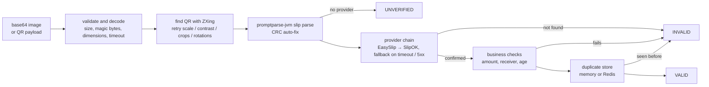

# slipverify-jvm — verify Thai transfer slips from a base64 image (Kotlin/JVM)

[](https://github.com/sunJirapath/slipverify-jvm/actions/workflows/ci.yml)
[](LICENSE)
[](https://github.com/sunJirapath/slipverify-jvm/actions/workflows/ci.yml)

Takes a slip image that your frontend sends as base64, finds the slip's mini QR, parses it with
[promptparse-jvm](https://github.com/sunJirapath/promptparse-jvm), optionally confirms it with a slip-verification
provider, runs your business checks (amount, receiver, age, duplicates) and returns **one typed result with reason
codes**. Java-friendly API, Spring Boot starter included. ตรวจสลิป Java / Kotlin.

> **Disclaimer:** not affiliated with, endorsed by, or sponsored by any bank or slip-verification provider.
> **An offline QR check is not proof of payment.** Anyone can print a slip QR. Only a provider's confirmation counts,
> and without a provider this library returns at most `UNVERIFIED`.

[English](#english) · [ภาษาไทย](#ภาษาไทย)

## English

### Status

Pre-release (`0.1.0-SNAPSHOT`), **not on Maven Central yet**. Build from source with `./gradlew publishToMavenLocal`.
Providers: EasySlip and SlipOK. RDCW is planned once its success response is documented
(see [docs/RESEARCH.md](docs/RESEARCH.md)).

### How it works



### Modules

| Module | Artifact | Contents |
|---|---|---|
| `core` | `slipverify-core` | result model, `SlipVerifier`, `SlipProvider` / `DuplicateStore` / `QrExtractor`, business checks, in-memory store |
| `image-zxing` | `slipverify-image-zxing` | base64 → image → slip QR (ZXing) |
| `provider-common` | `slipverify-provider-common` | HTTP + JSON helpers shared by providers |
| `provider-easyslip` | `slipverify-provider-easyslip` | [EasySlip](https://document.easyslip.com/en/v2/) API v2 |
| `provider-slipok` | `slipverify-provider-slipok` | [SlipOK](https://slipok.com/api-documentation/) |
| `store-redis` | `slipverify-store-redis` | duplicate store on Redis (`SET NX PX`, Lettuce) |
| `spring-boot-starter` | `slipverify-spring-boot-starter` | auto-config, properties, metrics, example controller (Boot 3, Java 17) |
| `examples` | – | plain Java and Spring Boot demos |

`core` depends only on promptparse-jvm. Libraries use Java 11 bytecode; the starter needs Java 17.

### Quick start: Spring Boot

```kotlin
dependencies {
    implementation("io.github.sunjirapath:slipverify-spring-boot-starter:<version>")
    implementation("io.github.sunjirapath:slipverify-provider-easyslip:<version>")
    // optional: slipverify-provider-slipok, slipverify-store-redis
}
```

```yaml
slipverify:
  provider-order: easyslip,slipok
  easyslip:
    api-key: ${EASYSLIP_API_KEY:}      # from the environment, never from source
  duplicate:
    store: memory                       # or redis (+ redis-uri)
  web:
    enabled: true                       # example endpoint POST /slips/verify (add auth + rate limiting!)
```

```java
@RestController
class PayController {
  private final SlipVerificationService slips;
  PayController(SlipVerificationService slips) { this.slips = slips; }

  @PostMapping("/pay/confirm")
  SlipVerificationResult confirm(@RequestBody ConfirmBody body) {
    return slips.verify(new SlipRequest(body.image(), null, new BigDecimal("150.00"),
        new ReceiverRule("1234", "สมชาย"), Duration.ofMinutes(30)));
  }
}
```

### Quick start: plain Java

```java
SlipVerifier verifier = SlipVerifier.builder()
    .qrExtractor(new ZxingQrExtractor())                                   // needed for imageBase64
    .provider(new EasySlipProvider(new EasySlipConfig(System.getenv("EASYSLIP_API_KEY"))))
    .duplicateStore(new InMemoryDuplicateStore())                           // or RedisDuplicateStore.connect(uri)
    .build();

SlipVerificationResult r = verifier.verify(new SlipRequest(
    base64FromFrontend,            // raw base64 or data URL; or null and pass the QR text as `payload`
    null,
    new BigDecimal("150.00"),      // expectedAmount (optional)
    new ReceiverRule("1234", "สมชาย"),  // expectedReceiver (optional)
    Duration.ofMinutes(30)));      // maxAge (optional)

if (r.getStatus() == VerificationStatus.VALID) { /* credit the order */ }
```

See [examples/](examples/) for runnable versions.

### Frontend snippet (JavaScript)

HEIC (iPhone) is not supported: converting through a canvas yields JPEG and also shrinks big photos.

```js
async function sendSlip(file) {
  const bitmap = await createImageBitmap(file);
  const scale = Math.min(1, 2000 / Math.max(bitmap.width, bitmap.height));
  const canvas = new OffscreenCanvas(bitmap.width * scale, bitmap.height * scale);
  canvas.getContext("2d").drawImage(bitmap, 0, 0, canvas.width, canvas.height);
  const jpeg = await canvas.convertToBlob({ type: "image/jpeg", quality: 0.9 });
  const dataUrl = await new Promise((resolve) => {
    const r = new FileReader();
    r.onload = () => resolve(r.result);        // "data:image/jpeg;base64,...."
    r.readAsDataURL(jpeg);
  });
  const res = await fetch("/slips/verify", {
    method: "POST",
    headers: { "Content-Type": "application/json" },
    body: JSON.stringify({ image: dataUrl, expectedAmount: 150.0 }),
  });
  return res.json();   // { status, reasons, amount, ... }
}
```

### Results and reason codes

`status` is `VALID`, `INVALID`, `UNVERIFIED` or `ERROR`. `VALID` needs a provider confirmation **and** every requested
check to pass. Reasons are an enum list; `CRC_AUTOFIXED`, `NO_PROVIDER_CONFIGURED` are informational.

| Group | Codes |
|---|---|
| Input / image | `EMPTY_INPUT`, `INVALID_BASE64`, `UNSUPPORTED_IMAGE_FORMAT` (also HEIC / WebP), `IMAGE_TOO_LARGE`, `IMAGE_DIMENSIONS_TOO_LARGE`, `IMAGE_DECODE_TIMEOUT` |
| QR | `NO_QR_FOUND`, `NOT_A_SLIP_QR`, `CRC_INVALID`, `CRC_AUTOFIXED` (info) |
| Provider | `NO_PROVIDER_CONFIGURED` (info), `PROVIDER_NOT_FOUND`, `PROVIDER_PENDING`, `PROVIDER_AUTH_ERROR`, `PROVIDER_QUOTA_EXCEEDED`, `PROVIDER_RATE_LIMITED`, `PROVIDER_TIMEOUT`, `PROVIDER_ERROR`, `PROVIDER_UNSUPPORTED_SLIP_TYPE` |
| Business | `AMOUNT_MISMATCH`, `RECEIVER_MISMATCH`, `TOO_OLD`, `TIME_UNAVAILABLE`, `DUPLICATE`, `DUPLICATE_STORE_ERROR` |

Fallback rules: timeout / network / 5xx → next provider; any 4xx (including 429), "not found" or "pending" → stop.
Each slip type is only sent to providers that support it. Missing data fails closed (for example `maxAge` without a
transfer time gives `TIME_UNAVAILABLE`).

### Slip type × provider support

| Slip type | promptparse-jvm | EasySlip | SlipOK | RDCW |
|---|---|---|---|---|
| Standard BOT slip | ✓ | ✓ (payload) | ✓ (payload) | planned |
| TrueMoney wallet slip | ✓ (offline) | ✓ (**needs the image**, not the payload) | not documented | planned |

Sources and open questions: [docs/RESEARCH.md](docs/RESEARCH.md).

### Security notes

- Slip data is personal data (PDPA). Images are never persisted; names and accounts are masked in results, logs and
  `toString()`. Do not log requests or provider responses yourself.
- API keys come from configuration or the environment. They are never printed, and exceptions carry no message from
  the remote side.
- Limits before decoding: 5 MB encoded (default), PNG/JPEG magic bytes, pixel and dimension caps read from the
  header (decompression bombs), a decode timeout.
- The duplicate store fails closed: if Redis is down the slip is not accepted.
- The example controller has **no authentication or rate limiting**. It enforces a body size limit and returns generic
  errors; details are logged at DEBUG on the server only.
- Receiver matching works on masked provider data, so it narrows but does not identify an account. Use the
  provider's own account linking for strong guarantees.

### Build

`./gradlew check` (format, detekt, tests, API check, 90% coverage). See [CONTRIBUTING.md](CONTRIBUTING.md).
Licensed under [Apache-2.0](LICENSE).

## ภาษาไทย

### สถานะ

รุ่นก่อนปล่อย (`0.1.0-SNAPSHOT`) **ยังไม่อยู่บน Maven Central** ใช้ `./gradlew publishToMavenLocal` เพื่อทดลอง
รองรับผู้ให้บริการ EasySlip และ SlipOK ส่วน RDCW จะเพิ่มเมื่อมีเอกสารรูปแบบผลลัพธ์ที่สำเร็จ

> **ข้อสงวนสิทธิ์:** โปรเจกต์นี้ไม่มีส่วนเกี่ยวข้องหรือได้รับการรับรองจากธนาคารหรือผู้ให้บริการตรวจสลิปรายใด
> **การอ่าน QR บนสลิปเพียงอย่างเดียวไม่ใช่หลักฐานการชำระเงิน** ใครก็สร้าง QR บนสลิปปลอมได้
> ต้องให้ผู้ให้บริการยืนยันเท่านั้น หากไม่ตั้งค่าผู้ให้บริการ ผลสูงสุดคือ `UNVERIFIED`

### ทำงานอย่างไร

รับรูปสลิปเป็น base64 จาก frontend → ตรวจขนาด/ชนิดไฟล์/ขนาดพิกเซล → ค้นหา QR ด้วย ZXing (ลองย่อ ขยาย ปรับคอนทราสต์
ตัด หมุน) → แปลงด้วย promptparse-jvm (ซ่อม CRC ที่ถูกตัดเลข 0 นำหน้าอัตโนมัติ) → ส่งให้ผู้ให้บริการยืนยัน
(สลับไปรายถัดไปเมื่อ timeout หรือ 5xx) → ตรวจยอดเงิน ผู้รับ อายุสลิป และสลิปซ้ำ → ได้ผลลัพธ์เดียวพร้อมรหัสเหตุผล

### เริ่มต้นใช้งานกับ Spring Boot

```yaml
slipverify:
  provider-order: easyslip,slipok
  easyslip:
    api-key: ${EASYSLIP_API_KEY:}   # ใส่ผ่าน environment ห้ามเขียนในโค้ด
  duplicate:
    store: memory                    # หรือ redis
```

```java
SlipVerificationResult r = slips.verify(new SlipRequest(
    body.image(), null, new BigDecimal("150.00"),
    new ReceiverRule("1234", "สมชาย"), Duration.ofMinutes(30)));
if (r.getStatus() == VerificationStatus.VALID) { /* ยืนยันออเดอร์ */ }
```

### เริ่มต้นใช้งานกับ Java ธรรมดา

ดูตัวอย่างที่รันได้ใน [examples/java](examples/java) และโค้ดเต็มในหัวข้อ English ด้านบน

### โค้ดฝั่ง frontend

ใช้ตัวอย่าง JavaScript ด้านบน: แปลงรูปผ่าน canvas เป็น JPEG ก่อนส่ง เพราะ **ไม่รองรับ HEIC ของ iPhone**
(จะได้ `UNSUPPORTED_IMAGE_FORMAT`) และช่วยลดขนาดรูปใหญ่ด้วย

### สถานะผลลัพธ์

| สถานะ | ความหมาย |
|---|---|
| `VALID` | ผู้ให้บริการยืนยันการโอน และผ่านทุกเงื่อนไขที่ร้องขอ (ยอด ผู้รับ อายุ สลิปซ้ำ) |
| `INVALID` | อ่านไม่ได้ ไม่พบในระบบ หรือไม่ผ่านเงื่อนไข ดูรหัสเหตุผล |
| `UNVERIFIED` | อ่าน QR ได้แต่ไม่มีผู้ให้บริการยืนยัน (ไม่ใช่หลักฐานการชำระเงิน) |
| `ERROR` | ระบบภายนอกขัดข้องหรือ timeout |

### ตารางประเภทสลิป × ผู้ให้บริการ

| ประเภทสลิป | promptparse-jvm | EasySlip | SlipOK | RDCW |
|---|---|---|---|---|
| สลิปมาตรฐาน ธปท. | ✓ | ✓ (payload) | ✓ (payload) | วางแผนไว้ |
| สลิป TrueMoney | ✓ (offline) | ✓ (**ต้องส่งรูป** ไม่รับ payload) | ไม่มีในเอกสาร | วางแผนไว้ |

### หมายเหตุด้านความปลอดภัยและ PDPA

- ข้อมูลบนสลิปเป็นข้อมูลส่วนบุคคล ไลบรารีไม่เก็บรูปภาพ และปิดบังชื่อ/เลขบัญชีในผลลัพธ์และ `toString()`
- API key ต้องมาจาก config หรือ environment เท่านั้น ไม่ปรากฏใน log หรือข้อความ exception
- ตรวจขนาดไฟล์ ชนิดไฟล์ และขนาดพิกเซลก่อนถอดรหัสรูป เพื่อกัน decompression bomb และมี timeout
- ถ้า Redis ล่ม สลิปจะไม่ถูกยอมรับ (fail closed)
- controller ตัวอย่าง **ไม่มีระบบยืนยันตัวตนและ rate limit** ต้องเพิ่มเองก่อนเปิดใช้งานจริง
